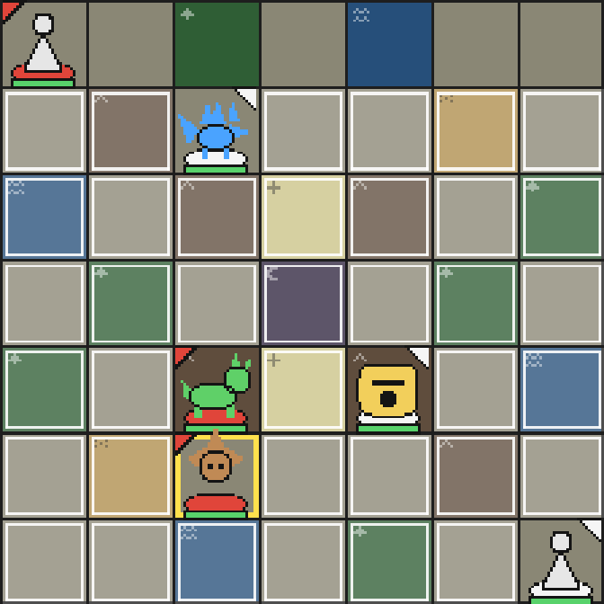
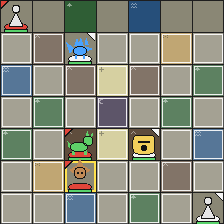
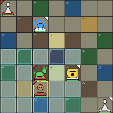
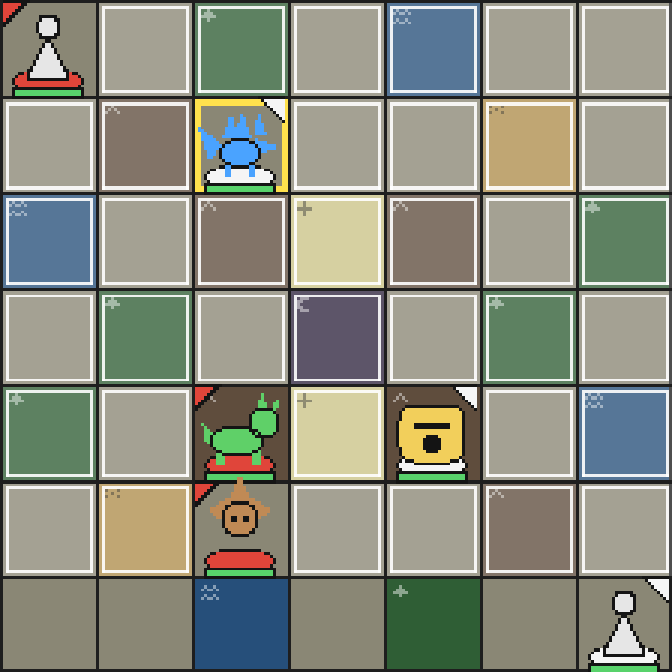
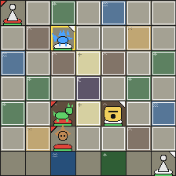

# Ticket 19 cancellation review

Linux, Playwright 1.62.1 Chromium 151.0.7922.34 (build 1234).
All six images were inspected: the translucent preview is gone, and the Move
or Blink destination highlights remain. Each image also matched the canvas
captured before the preview, byte for byte. Session assertions verify that the
Unit remains selected, mode/destinations and Battle revision/action count stay
the same, and the panel disappears. Every case then chooses a new destination
and confirms through the real UI.

The detached integration worktree applied ticket 19 commit `c51c817` on ticket
10 commit `774b4e7`. All 27 comparisons passed without changing any baseline.
The preview captures are the same as ticket 10's refreshed images; both tickets
started separately from `origin/main` commit `8aa2d68`. Merge ticket 10 first to
refresh the stale Replay fixtures before ticket 19's standalone visual CI can
compare images.

| Case | 1280 px viewport | 360 px viewport |
| --- | --- | --- |
| move |  |  |
| blink |  |  |
| blocked |  |  |
