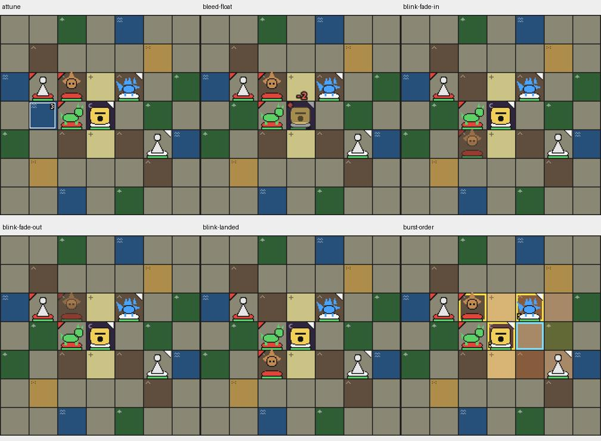
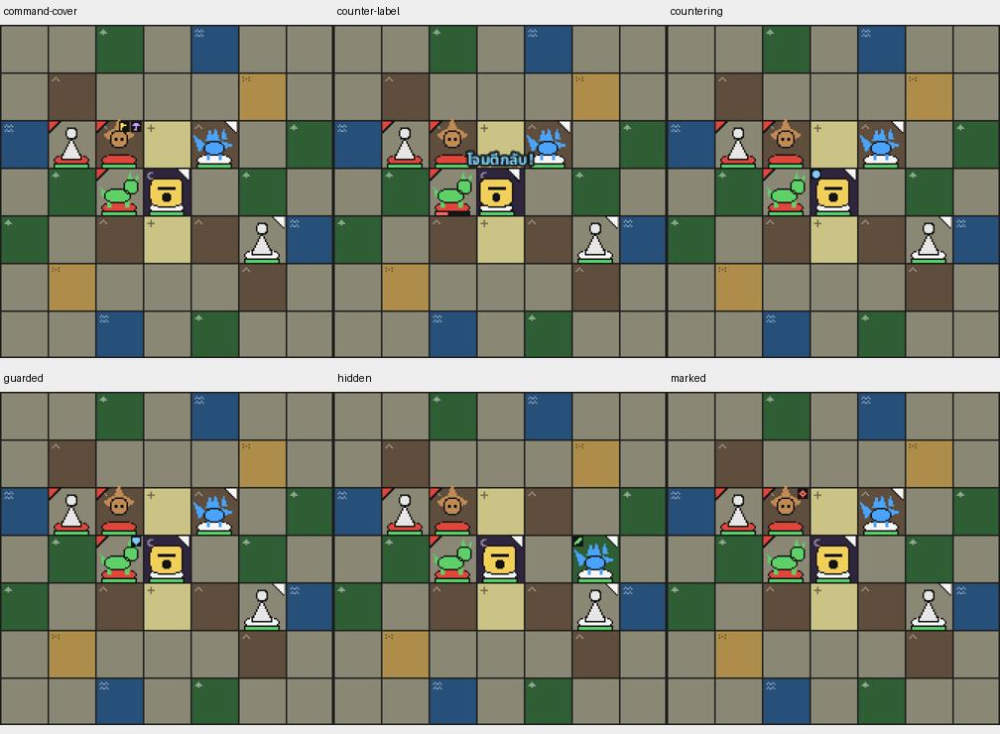
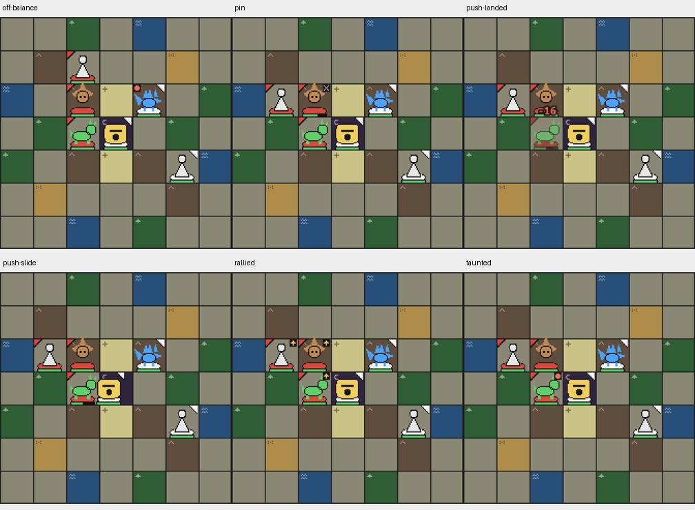
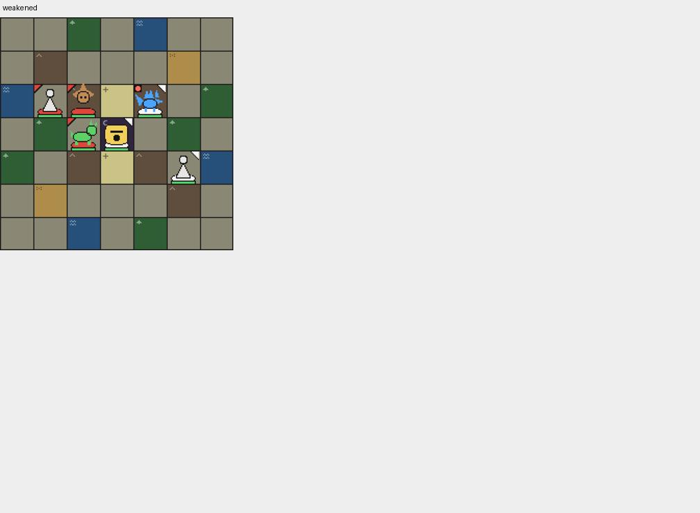

# P1X-30 visual refresh

Regenerated all 16 Replay fixtures on main `d24c252` (engine 0.12.0, data hash unchanged). Every generated action remains legal and `check-replays` exits 0. The only JSON difference is `engineVersion` 0.11.0 → 0.12.0; actions, Dice Seeds, positions and event-producing steps are unchanged.

`test:visual:update` on Linux with Playwright 1.62.1 / Chromium 151.0.7922.34 (build 1234) passed 27/27. All 25 baseline PNGs are byte-identical to the committed before images, so no binary baseline replacement is needed. Inspected every Board frame and all six desktop/mobile Move preview images: Burst numbering, Blink opacity/landing, push, Counter label, Bleed damage, Attune duration, Command/Cover and all status icons remain correct and legible. No new visual defect was found.

The contact sheets below show the 19 Board frames; the full-resolution PNGs, including all six UI captures, are indexed below. Before and after are identical.

- [attune.png](../../../../packages/web/visual/baselines/attune.png)
- [bleed-float.png](../../../../packages/web/visual/baselines/bleed-float.png)
- [blink-fade-in.png](../../../../packages/web/visual/baselines/blink-fade-in.png)
- [blink-fade-out.png](../../../../packages/web/visual/baselines/blink-fade-out.png)
- [blink-landed.png](../../../../packages/web/visual/baselines/blink-landed.png)
- [burst-order.png](../../../../packages/web/visual/baselines/burst-order.png)
- [command-cover.png](../../../../packages/web/visual/baselines/command-cover.png)
- [counter-label.png](../../../../packages/web/visual/baselines/counter-label.png)
- [countering.png](../../../../packages/web/visual/baselines/countering.png)
- [guarded.png](../../../../packages/web/visual/baselines/guarded.png)
- [hidden.png](../../../../packages/web/visual/baselines/hidden.png)
- [marked.png](../../../../packages/web/visual/baselines/marked.png)
- [off-balance.png](../../../../packages/web/visual/baselines/off-balance.png)
- [pin.png](../../../../packages/web/visual/baselines/pin.png)
- [preview-blink-1280.png](../../../../packages/web/visual/baselines/preview-blink-1280.png)
- [preview-blink-360.png](../../../../packages/web/visual/baselines/preview-blink-360.png)
- [preview-blocked-1280.png](../../../../packages/web/visual/baselines/preview-blocked-1280.png)
- [preview-blocked-360.png](../../../../packages/web/visual/baselines/preview-blocked-360.png)
- [preview-move-1280.png](../../../../packages/web/visual/baselines/preview-move-1280.png)
- [preview-move-360.png](../../../../packages/web/visual/baselines/preview-move-360.png)
- [push-landed.png](../../../../packages/web/visual/baselines/push-landed.png)
- [push-slide.png](../../../../packages/web/visual/baselines/push-slide.png)
- [rallied.png](../../../../packages/web/visual/baselines/rallied.png)
- [taunted.png](../../../../packages/web/visual/baselines/taunted.png)
- [weakened.png](../../../../packages/web/visual/baselines/weakened.png)

Checks: frozen install, typecheck, 1,028 tests passed (1 skipped), build. Three repeated visual comparisons and path check are recorded in the PR.

The `--with-deps` browser install could not use `su` (no root password). Installing Chromium alone succeeded; existing system libraries support the pinned browser. Browser cache: `/workspace/.cache/ms-playwright`.
